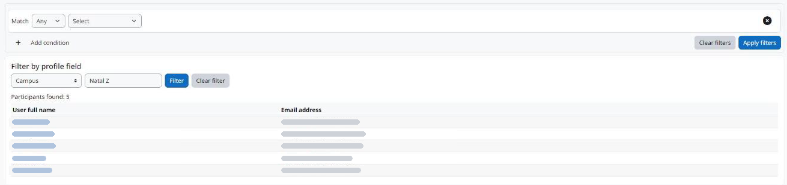

Participants custom field filter
================================

**tool_participantscustomfilter** adds a filter by custom user profile fields to the course
participants page (*Course > Participants*, ``/user/index.php``). Pick a profile field, type part
of the value and the plugin lists the participants of the course whose field contains it.

   The panel below the standard filters, filtering by the *Campus* field.

Main features
-------------

- Filter by any custom profile field the viewer is allowed to see.
- Partial, case-insensitive match (``natal`` finds ``Natal`` and ``Parnamirim (near NATAL)``).
- Only participants with an active enrolment in the course are listed.
- Respects separate groups: teachers without *Access all groups* only see their groups.
- Shows the identity fields configured in *Show user identity* (``showuseridentity``).
- Paged results with a link to each participant's course profile.
- Stores no personal data and adds no database table.

Supported versions: Moodle 5.3 LTS.

.. toctree::
   :maxdepth: 2
   :caption: Contents:

   installation
   configuration
   usage
