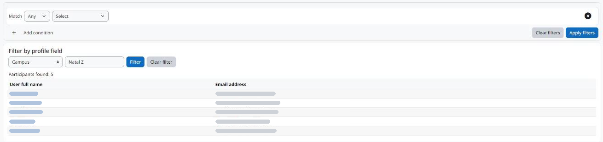

Filtro de participantes por campo personalizado
===============================================

O **tool_participantscustomfilter** acrescenta um filtro por campos personalizados do perfil do
usuário à página de participantes do curso (*Curso > Participantes*, ``/user/index.php``). Escolha um
campo do perfil, digite parte do valor e o plugin lista os participantes do curso cujo campo o contém.

   O painel abaixo dos filtros padrão, filtrando pelo campo *Campus*.

Principais recursos
-------------------

- Filtro por qualquer campo personalizado do perfil que o usuário pode ver.
- Busca parcial e sem diferenciar maiúsculas (``natal`` encontra ``Natal`` e ``Parnamirim (perto de NATAL)``).
- Só lista participantes com inscrição ativa no curso.
- Respeita grupos separados: professores sem *Acessar todos os grupos* só veem os seus grupos.
- Mostra os campos de identidade configurados em *Mostrar identidade do usuário* (``showuseridentity``).
- Resultados paginados, com link para o perfil de cada participante no curso.
- Não guarda dados pessoais nem cria tabela no banco.

Versões suportadas: Moodle 5.3 LTS.

.. toctree::
   :maxdepth: 2
   :caption: Conteúdo:

   installation
   configuration
   usage
